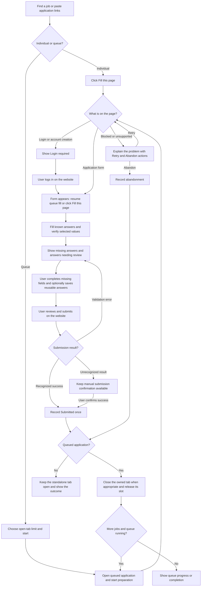

# Proposal: a cohesive application workflow

**Status:** Proposal for owner and collaborator review. Implementation requires approval of this plan.

**Updated:** October 16, 2026

**Purpose:** Align contributors on how Job Autofill should behave when filling one application or preparing a queue of applications. This document describes intended behavior and acceptance criteria; it is not a claim that these features have shipped.

## Contents

- [Product direction](#product-direction)
- [Problems to resolve](#problems-to-resolve)
- [User flow](#user-flow)
- [Sidebar design](#sidebar-design)
- [Application states and recovery](#application-states-and-recovery)
- [Login and navigation](#login-and-navigation)
- [Review priorities and field feedback](#review-priorities-and-field-feedback)
- [Profile, presets, and Memories](#profile-presets-and-memories)
- [Queue behavior](#queue-behavior)
- [Submission confirmation and tracking](#submission-confirmation-and-tracking)
- [Technical design](#technical-design)
- [Performance and privacy](#performance-and-privacy)
- [Implementation sequence](#implementation-sequence)
- [Validation and release criteria](#validation-and-release-criteria)
- [Decisions for review](#decisions-for-review)

## Product direction

Make the extension a cohesive daily tool with one understandable pipeline:

**Open → Fill → Review → Remember reusable answers → Submit on the website → Confirm success → Next application.**

Users enter this pipeline through either **Fill this page** or **Start queue**. Both entry points must use the same filling, matching, verification, and recovery behavior. A queued application should not miss approved Memories that a manual fill would use.

Build on existing profiles, platform adapters, presets, Memories, uploads, optional AI responses, application tracking, and optional Google Sheets integration. Audit the current branch before implementation: some foundation work exists locally and must be verified and preserved. The sections below are proposed outcomes, including improvements to existing behavior.

### Goals

- Make manual work obvious: show what is missing, why it needs attention, and what the user can do next.
- Keep application preparation moving while the user reviews other applications.
- Make interrupted jobs recoverable without duplicate tabs, lost state, or overwritten edits.
- Keep the interface compact without hiding essential actions.
- Establish measurable reliability and performance results suitable for a portfolio and interview discussion.

With a complete Profile and relevant approved Memories, aim to fill at least **90% of eligible reusable fields on a defined supported-form benchmark**. Measure incorrect fills separately: skipping an uncertain field is preferable to inserting an incorrect fact. Employer-specific essays, credentials, CAPTCHA, and unsupported uploads should not inflate the denominator.

The user's aspiration is to complete 15 applications in the time previously needed for three. Treat that as a **fivefold throughput target to measure**, not a promised result. Record both active user time and total elapsed time.

### Boundaries

- The user reviews and submits every application on the website. Detecting a successful submission does not mean submitting automatically.
- The extension never invents applicant facts, signs into accounts, enters verification codes, or solves CAPTCHA.
- Keep data local by default; existing external integrations remain opt-in.
- Keep broad job search, LinkedIn automation, a separate tracking dashboard, and an interactive demo playground outside this restructuring effort.
- Retain the current stack. No backend, database service, or framework replacement is proposed.

## Problems to resolve

| Current inconsistency to audit | Intended behavior |
| --- | --- |
| Fill controls can disappear inside collapsible or reordered sections. | A compact, permanent Fill this page action stays at the top. |
| Duplicate summaries and expanded cards compete for sidebar space. | One current-application summary and one attention workspace. |
| A login page can look like an empty or unsupported application. | Explicit Login required state with a clear way to resume. |
| Submission detection and recovery differ between queued and individual applications. | Shared confirmation logic with a persistent manual fallback. |
| Manual confirmation can disappear while a page is loading or reporting an error. | Actions remain associated with the tracked application through navigation. |
| Batch behavior and open-tab capacity are easy to confuse. | Use the label Applications open at once and continuously replace completed jobs. |
| Queue fills can miss fields that a manual retry fills successfully. | Same readiness checks, approved answer sources, and bounded recovery path. |
| Previously tracked jobs may all be treated as duplicates. | Handle submitted, unfinished, abandoned, and already queued jobs differently. |
| A retry can report zero newly filled fields even when the form is mostly complete. | Separate overall completion from writes made in the latest attempt. |

The existing continuous queue controller already has a capacity-update path. Verify and extend it rather than adding a competing scheduler.

## User flow



For one application, the user opens the page, fills it, completes the highlighted gaps, optionally remembers answers, and submits. If login is required, they log in on the website and then fill the application.

For a queue, the user pastes links and starts preparation. The extension prepares a bounded number of applications while the user reviews one. Confirmed completion or abandonment frees a slot for the next job. A login or blocked application remains visible without stopping preparation in other occupied slots.

## Sidebar design

The core sidebar should answer three questions immediately: **What can I do now? What needs my attention? What is the queue doing?**

Illustrative layout, using fictional information:

```text
Job Autofill                                  Settings

[ Fill this page ]
Software Engineer · Example Company
3 missing · 2 answers to review                 Details ▾

CURRENT APPLICATION
[ Missing answers (3) ] [ Review (2) ]

On-site availability
Answer on the page.                            [ Show field ]

Start date
Answer entered — ready to remember.
[ Remember answer ]

[ Save all answered questions (1) ]
[ I submitted this application ]
Having trouble?                                [ Get help ]

APPLICATION QUEUE
3 open · 8 waiting · 4 submitted
Applications open at once: [ 3 ▾ ]              [ Pause ]

Current application                            Reviewing
Another prepared application                   [ Open ]
An application requiring login                 [ Open ]
More queue controls ▾

Presets ▸
Applications ▸
```

### Layout rules

- Keep Fill this page visible at the top, including during sidebar scrolling. It cannot be collapsed, hidden, or dragged below optional categories.
- Show the role, company, and meaningful attention counts. Put detailed statistics, resume information, and diagnostics behind Details.
- Hide unhelpful zero-value statistics such as 0 AI-written.
- Automatically expose the current attention list when there are gaps. Move resolved items out of the main list.
- Provide one clear workspace for current missing answers, review, and remembering. Avoid another full duplicate application card in the queue.
- Keep the queue compact: state, capacity, progress, and a direct way to open a job.
- Keep presets and history collapsed by default. Respect saved expansion, visibility, and ordering preferences for optional sections below the fixed core.
- Use plain-language feedback after every action. Saving, retrying, and errors appear beside the relevant control.
- Support keyboard navigation and visible focus. Labels and icons must communicate state alongside color.

## Application states and recovery

Use one authoritative application lifecycle. Page readiness, fill progress, and submission outcome should remain separate concepts so an optional task cannot lock the entire interface.

| User-visible state | Explanation and available action |
| --- | --- |
| Ready to start | Fill this page. |
| Loading application | Show bounded progress; offer help or cancellation. |
| Login required | Ask the user to sign in on the website; preserve the application context. |
| Filling | Show the current phase; allow Finish manually. |
| Needs answers | List missing fields with reasons, Show field, and remembering actions. |
| Ready for review | The writer has stopped; the user can review and submit on the website. |
| Checking submission | Look for confirmation while retaining an appropriate manual fallback. |
| Submitted | Show the confirmed outcome and separate integration sync status. |
| Blocked | Explain the actual issue; offer Retry or Abandon. |
| Abandoned | Preserve the outcome in history and release the queue slot when its tab is closed. |

Ready for review must mean the extension is no longer writing into the form. Optional metadata lookup, AI work that has been canceled, and Google Sheets synchronization must not prevent the user from answering or saving Memories.

Finish manually cancels outstanding writes and waits for the writer to stop. Late callbacks from the canceled attempt cannot overwrite subsequent user edits or update a newer attempt.

## Login and navigation

- Detect a combination of signals: visible sign-in controls, password or verification screens, supported platform routes, and whether a real application form is present. Avoid relying only on field count.
- Tell the user Login required rather than showing indefinite Filling or a generic failure.
- Never fill credentials, verification codes, or CAPTCHA fields.
- For an individual application, keep Fill this page available after login.
- For a queued application, preserve the intended job and resume preparation once a supported application form is ready. Offer Resume when readiness is uncertain.
- Treat redirects and login popups as changes requiring ownership checks. Do not adopt or close an unrelated tab. If necessary, ask the user to explicitly associate the destination with the application.
- A login-waiting job occupies an open-tab slot but does not block filling other jobs.
- Use bounded readiness checks and actionable timeouts. A job cannot remain an unexplained spinner forever.

## Review priorities and field feedback

Prioritize required missing fields, then answers needing review, then optional gaps. Every item should explain the problem and the next action.

Examples:

- Start date: No saved Profile answer. Enter it on the page, then save it to your Profile.
- Academic transcript: Upload this document on the application page.
- Citizenship: No verified matching option. Choose the correct option on the page, then confirm whether it can be reused.

Show field should scroll once to the correct control and briefly highlight it. Filling in background tabs must not repeatedly scroll or steal focus. Preserve non-empty page values unless the user explicitly chooses replacement.

| Visual treatment | Meaning |
| --- | --- |
| Green + Verified | A saved fact or approved Memory was applied and verified against the control's selected value. |
| Amber + Review | A generated draft or interpretation needs the user's attention. |
| Red + Missing | A required answer is missing or a write could not be verified. |
| Neutral + Entered by you | An existing user answer was preserved. |

These are evidence-based review priorities, not invented confidence percentages. Green does not guarantee that an applicant fact is current. Sensitive eligibility answers remain inspectable, and unfamiliar meanings must not be filled merely because a text similarity score is high.

## Profile, presets, and Memories

### Remembering an answer

1. The user answers a missing review question on the website.
2. The sidebar indicates that the question appears answered and enables Remember answer. Readiness feedback should not capture unrelated page values.
3. Clicking Remember explicitly requests capture of that question's answer.
4. Show the captured answer and proposed reuse scope for confirmation.
5. Save only after confirmation, then show a clear success message.

Save all answered questions explicitly requests capture of the answered review questions included in that batch. Show their answers and scopes together before saving. Do not scan and silently save every answer on the page.

### Choose the right destination

- A direct Profile fact, such as a missing GPA, updates the relevant Profile field after confirmation. Confirm replacement if a conflicting value already exists.
- A contextual answer, such as willingness to commute to a particular office, becomes an appropriately scoped Memory.
- Role-specific prepared content stays associated with the selected preset where applicable.
- Keep the active preset visible in a compact control. Freeze the preset and answer-source context for an active fill attempt; define changes to waiting jobs explicitly rather than silently switching an in-progress job.
- Keep full Memory management in Settings. The sidebar focuses on capturing and confirming answers needed by the current application.

### Handle variations quickly and conservatively

Use local matching first: normalize formatting, check exact approved questions, resolve approved question meanings, check context and scope, then match approved answer equivalents to actual options.

Country, subject, timeframe, education level, and negation must agree. A degree abbreviation can resolve to an approved equivalent without treating a graduate GPA as an undergraduate GPA. Willingness to commute to one office must not become a global Yes to relocation.

All applications is the broadest scope, not a substitute for narrower scopes. Narrower company, site, or application scopes prevent inappropriate reuse. Conflicting applicable answers should require review rather than silently choosing one.

Unfamiliar wording is a suggestion requiring confirmation. Optional AI can propose aliases or wording after a user click, with individual approval before saving. Routine reuse must not require an AI request or slow down known-answer filling.

Preserve the existing explicit-consent boundaries for demographic and eligibility information. Never infer these facts from unrelated answers.

## Queue behavior

### Capacity and continuous replacement

Default to **three applications open at once**, configurable from one to five initially. This is a capacity limit, not a requirement to finish an entire batch before starting another job.

- Changing three to five opens exactly two more jobs when at least two are waiting, or one if only one remains.
- If nothing is waiting, explain that the queue has no more jobs to open.
- Reducing five to two keeps existing tabs open. Start no replacements until occupancy falls below two.
- Count loading, filling, login-waiting, blocked, and review-ready owned application tabs toward the limit.
- Keep pending jobs as metadata; do not open all pasted URLs in advance.
- Add links while a queue is running without resetting progress.
- Pause stops new openings while allowing current review, submission confirmation, and recording to continue. Resume reevaluates available capacity.
- Put Stop and other less frequent controls in a clearly labeled secondary area. Stop keeps already opened applications available and explains the outcome.
- Keep any legacy batch mode separate from the default continuous workflow so its semantics cannot leak into the main controls.

### Duplicates and previously tracked jobs

| Existing state | Proposed behavior |
| --- | --- |
| Duplicate pasted URL | Keep one queue entry and report the duplicate. |
| Already queued or open | Open the existing entry instead of creating another. |
| Unfinished tracked application | Offer resume. |
| Previously submitted | Skip by default with an explanation. |
| Previously abandoned | Allow an explicit retry. |

### Abandon and retry

Keep an accessible way to say I cannot continue, including during a stalled fill. Cancel and settle the writer before handing control back. Record Abandoned separately from Submitted.

For a queued job, explicitly abandoning and closing its owned tab releases a slot and advances the queue when running. If closing fails, show recovery and keep occupancy accurate. For an individual job, leave the tab open unless the user also chooses to close it.

## Submission confirmation and tracking

Use the same submission observer for individual and queued applications, with platform-specific evidence behind adapters.

- A user submit action establishes intent; it is not evidence of success by itself.
- Confirm success only with supported confirmation evidence tied to the application, job, tab, frame, and attempt.
- A disappearing form, changed URL, button click, or empty page alone is insufficient.
- Validation errors keep the application open and return the user to the attention list.
- Keep the tracked application's identity through confirmation navigation. The sidebar must not lose its manual confirmation action because the original form disappeared.
- Start with well-tested Greenhouse behavior, then add tested Lever and Ashby confirmation patterns. Treat variable systems such as Workday as separate adapter work.
- Unsupported or ambiguous outcomes remain open for review.

**I submitted this application** is the explicit fallback when automatic confirmation cannot recognize the website's result. Keep it accessible for a tracked unfinished application even if page extraction fails. Store whether success was detected or user-confirmed; do not present an unconfirmed attempt as Submitted.

For a confirmed queued application, save the outcome locally once, close only the owned application tab when appropriate, release capacity, and start the next waiting job. If the completed tab was active, hand off to the next prepared job. Completing a background job must not steal focus.

For a confirmed individual application, keep the tab open by default and offer Close tab.

Google Sheets synchronization follows the local outcome asynchronously. A sync failure should show Submitted — sheet sync needs retry, without blocking the queue or encouraging another application submission. Retries must not create duplicate application records or sheet entries.

## Technical design

Keep TypeScript, strict schemas, React, WXT / Manifest V3, local extension storage, Vitest, and Playwright. Reuse the current storage mechanisms and shared contracts rather than introducing a new persistence layer for this work.

### Shared application controller

Introduce or consolidate a controller that both Fill this page and the queue invoke. It owns lifecycle transitions and derives the available actions. Keep extraction, matching, preview, writing, and verification separate.

Events include Start fill, Login required, Form ready, Field verified, User edited, Finish manually, Submit attempted, Submit confirmed, Retry, Abandon, and Tab closed.

- Identify application records, fill attempts, queue runs, and owned tabs explicitly.
- Verify message sender, frame, and destination before accepting results.
- Reject stale attempt results after cancellation, retry, navigation, or preset changes.
- Make claims, completions, tab creation, and recording idempotent. Repeated clicks cannot create duplicate work.
- Persist important transitions and pending intent. Do not rely on service-worker globals for durable state.
- Reconcile live tabs after worker restart. After browser restart, stale tab IDs must never authorize closing an unrelated tab.
- Use runtime validation, versioned schemas, and migrations for changed records and messages.
- Update consumers and [contracts](CONTRACTS.md) in the same implementation change.

The queue controls capacity and scheduling; it does not maintain a second implementation of field filling. Both paths use the same form readiness, Profile, preset, approved Memories, and verification logic. Apply known local answers before optional AI responses. Retry only unresolved eligible fields, with bounded attempts and preservation of user edits.

Use [Chrome's service-worker lifecycle documentation](https://developer.chrome.com/docs/extensions/develop/concepts/service-workers/lifecycle) when designing restart recovery.

## Performance and privacy

- Default to three owned application tabs and initially cap the control at five. Explain that the limit controls open tabs, not guaranteed memory use.
- Measure extension overhead against the same sites opened without active filling. Third-party pages may dominate RAM use.
- Limit simultaneous optional AI requests and avoid large repeated Profile copies.
- Prefer relevant, debounced form observers over repeated full-page scanning. Disconnect observers and timers when attempts finish.
- Bound dropdown waits, readiness checks, retries, and network tasks. Surface delays with recovery actions.
- Keep the sidebar responsive while work happens in other tabs; do not activate tabs just to update progress.
- Preserve credentials, resumes, personal profiles, and exports outside version control.
- Diagnostics may describe adapter, control type, phase, reason code, and build version. Exclude applicant answers and credentials.
- Show a useful build/version indicator and stale-content-script recovery instructions to reduce confusion after extension reloads.

## Implementation sequence

Implement in small, reviewable changes after approval. This is an integration effort, not a wholesale rewrite.

| Phase | Work | Exit condition |
| --- | --- | --- |
| 1. Establish the baseline | Preserve local work, inspect current behavior and contracts, reproduce gaps with controlled fixtures. | Known failures and existing protections are documented in tests. |
| 2. Unify lifecycle handling | Share the application controller, ownership, cancellation, persistence, and transitions. | Standalone and queued entry points produce equivalent fill results and recover predictably. |
| 3. Simplify the sidebar | Pin Fill, compact the summary, consolidate attention controls, retain optional category preferences. | Essential actions remain visible across loading, review, and failure states. |
| 4. Handle login and navigation | Add explicit waiting states and safe resume behavior. | Login does not block unrelated jobs or lose the tracked application. |
| 5. Improve review and learning | Add evidence-based field priorities, Show field, and confirmed Profile/Memory destinations. | Users can finish manually and save correct reusable answers without overwritten edits. |
| 6. Finish queue controls | Verify live capacity changes, adding links, duplicate handling, pause, abandon, and continuous replacement. | Three to five opens exactly two more eligible jobs, with no duplicate claims. |
| 7. Unify submission outcomes | Shared supported confirmation, persistent manual fallback, tab handoff, local tracking and independent Sheets retry. | Failed submission never advances; confirmed completion records and advances once. |
| 8. Harden recovery and performance | Exercise stale results, worker/browser restarts, observer cleanup, accessibility, and resource overhead. | No known blocking recovery failures in the supported test matrix. |
| 9. Measure and package | Benchmark coverage and time savings, update user documentation, produce a versioned installable build. | Results are reproducible and limitations are explicit. |

Before each phase, inspect what the branch already implements. Keep working behavior and avoid rebuilding mechanisms that already satisfy the requirement. Coordinate contracts, shared storage, and manifest changes with the other contributor. Separate clones or worktrees are required for simultaneous editing.

Use focused branches and PRs with a specific owner, affected modules, actual checks, and remaining limitations. Update architecture and roadmap documentation when the implementation changes those decisions.

## Validation and release criteria

### Required scenarios

| Scenario | Expected result |
| --- | --- |
| Fill one supported form | Known answers populate and verified selections remain selected after rerender. |
| Fill after login | No credentials are entered; the application is recognized and can be filled. |
| One queued job requires login | Other open jobs continue preparing; the waiting job can resume. |
| Dropdowns or conditional fields load late | Bounded readiness/recovery handles them or gives an actionable fallback. |
| User edits during rerender or retry | Their non-empty answers survive. |
| A canceled AI response returns late | It cannot overwrite the user or a newer attempt. |
| Save one answer or Save all | Only requested review fields are captured, confirmed, and reused within approved scope. |
| Change capacity from three to five | Exactly two additional jobs open when available. |
| Reduce capacity below current occupancy | Existing applications stay open; no replacement exceeds the new limit. |
| Submit with validation errors | The application is not marked Submitted or closed. |
| Supported submission succeeds | Record once, close only the appropriate owned queue tab, and replace once. |
| Submission result is unfamiliar | Manual confirmation stays accessible; the tab is not closed prematurely. |
| Abandon a stalled job | Writes stop, outcome stays distinct, and capacity recovers correctly. |
| Worker or browser restarts | Restore durable intent without duplicate jobs or ownership based on stale tab IDs. |
| Sheets synchronization fails | Local submission remains recorded and queue progress continues; retry does not duplicate entries. |
| Repeated clicks or retries | No duplicate writes, application records, queue claims, or tabs. |

Include native selects, searchable custom dropdowns, multiselects, uploads, delayed controls, conditional questions, and authentication fixtures.

Use unit tests for transitions and matching, and real-extension Playwright tests with fictional applications for browser behavior. Run repository checks, type checking, unit tests, build, and relevant browser tests for implementation changes. Supervised checks on actual supported sites can supplement fixtures without submitting fictional applications to employers.

Passing controlled tests cannot guarantee every third-party form is bug-free. Publish the supported platform/widget matrix and known limitations. A release should have no known blocking failures in its stated supported workflow.

### Evidence for a portfolio

Measure eligible-field coverage, incorrect-fill rate, time to first review, active user time, total throughput, restart recovery, and extension memory overhead. Use those measured results in resume claims rather than invented percentages.

The engineering story should emphasize verified DOM interaction, reusable scoped knowledge, a persistent Manifest V3 workflow, bounded scheduling, recoverable failures, and accessible review controls.

Prepare a versioned installable package, clear setup and update instructions, privacy and permission explanations, release notes, and synthetic screenshots or a short recorded walkthrough using the existing fixtures. Publishing to the Chrome Web Store is a separate explicit release decision; this proposal does not authorize a store submission.

## Decisions for review

Recommended defaults for owner and collaborator approval:

1. Pin Fill this page at the top and consolidate missing answers and review into one current-application workspace.
2. Use continuous replacement with three open applications by default and an initial configurable limit of five.
3. Allow capacity changes during a queue without closing existing jobs when the limit decreases.
4. Detect supported submission confirmations only after user submission, with an always-discoverable manual fallback.
5. Close confirmed owned queue tabs and advance; keep standalone tabs open by default.
6. Keep remembering explicit and confirmed, with Profile updates for direct facts and scoped Memories for contextual answers.
7. Keep Sheets synchronization independent from local completion and queue progress.
8. Deliver the work in the phases above, validating each phase before expanding scope.

Agree on these defaults, any changed priorities, and module ownership before implementing this restructuring. Publishing this proposal is for communication and review, not approval of the implementation itself.

Related project guidance: [shared instructions](../AGENTS.md), [architecture](ARCHITECTURE.md), [contracts](CONTRACTS.md), [roadmap](ROADMAP.md), and [collaboration](COLLABORATION.md).
